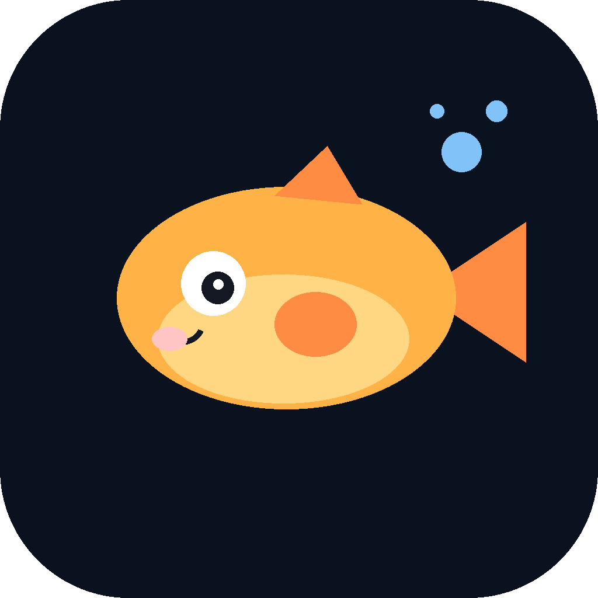
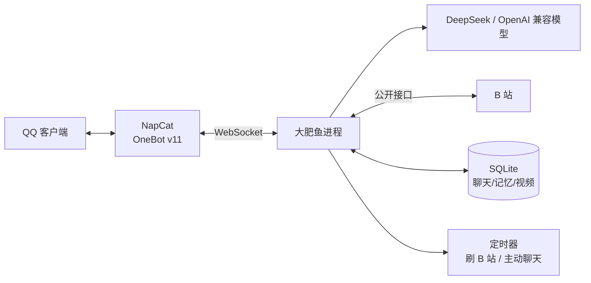

# 大肥鱼 QQ 机器人

<p align="center">
  
</p>

<h1 align="center">大肥鱼 · 奥米</h1>

<p align="center">一条住在 QQ 里的 AI 胖鱼：会陪你聊天、记事、<b>自己刷 B 站</b>，把学到的内容整理成技能卡，还会<b>到点主动来找你</b>。</p>

<p align="center">
  <a href="#macos-app">macOS App</a> ·
  <a href="#快速开始">快速开始</a> ·
  <a href="#人格调试精确版">人格调试</a> ·
  <a href="#电脑感知与远程协助macos">电脑感知</a> ·
  <a href="#21-b-站学习--技能库">B 站学习</a> ·
  <a href="docs/ARCHITECTURE.md">架构</a>
</p>

灵感来自 B 站 UP 主 [@泽轩604](https://space.bilibili.com/508225300) 的视频
[《DeepSeek大肥鱼接入QQ从零教程（升级版）》](https://www.bilibili.com/video/BV1bpxe61EU6/)。
本项目是独立实现，不依赖视频里的文档或 Skill，代码全部在这个仓库里。

> 说明：这里的「看视频」是读取视频的标题、简介、标签、热评，配置 Cookie 后还能读字幕；
> 它不会下载或理解画面。想让它真的「看懂画面」，需要另外接视觉模型。

---

## macOS App

除了命令行，也可以把它打包成一个真正的 macOS `.app`，双击打开后在控制台里管理配置、人格、启停和日志。

```bash
git clone https://github.com/YethenLOL/AI-solemate-agent.git dafeiyu-qq
cd dafeiyu-qq

# 1. 准备 Python 环境
bash scripts/setup.sh

# 2. 构建 App（会生成 dist/Dafeiyu.app）
bash scripts/build_app.sh

# 3. 打开
open dist/Dafeiyu.app
```

App 里包含：

- 概览：NapCat WebUI / OneBot / 机器人运行状态，一键启动/停止；**Token 消耗**按日 / 周 / 月统计并画柱状图
- 配置：DeepSeek Key、主人 QQ、模型、WS 地址、Token、B 站 Cookie、主动聊天、电脑感知、B 站学习开关
- 人格：直接编辑 `personas/dafeiyu.md`，保存后下一条消息生效
- 技能：查看/搜索奥米从主人 B 站观看历史里学到的技能卡；可以「立即学习」，也可以「重新蒸馏」把旧卡升级成可执行格式
- 日志：实时查看机器人日志
- 帮助：NapCat 安装、辅助功能/自动化权限、安全边界

> App 是 **ad-hoc 签名、未公证** 的；从 GitHub 下载后首次打开如果被 Gatekeeper 拦截，右键 → 打开，或到「系统设置 → 隐私与安全性」允许。
> 正式发布建议使用 Apple Developer ID 签名并 notarize，见 [docs/PACKAGING.md](docs/PACKAGING.md)。
>
> **NapCat、QQ 不随 App 分发**，需要用户自行安装并扫码登录机器人号。

---

## 它能做什么

- **QQ 私聊**：接入 NapCat（OneBot v11），用 DeepSeek 或任何 OpenAI 兼容模型聊天。
- **有记忆**：说「记住 我周末要考试」就会写进 SQLite，之后聊天会自然用上；也可以让它「想想我喜欢喝什么」。
- **自己刷 B 站**：后台每隔一段时间拉热门、排行榜，把没见过的视频记下来；也会按你的话去搜索、看视频详情和热评。
- **从 B 站学习 → 可执行技能卡**：读取主人自己的观看历史，把知识蒸馏成带「工具 / 网站 / 操作步骤 / 命令 / 易错点」的本地 Markdown 技能；主人私聊提到相关话题时自动带上摘要，也能让她读取完整技能并帮你操作电脑。
- **主动找你**：随机 50~140 分钟发一条消息，分享刚刷到的视频，或者结合记忆问你一件具体的小事；凌晨静音、每天有上限、你刚聊完不会马上打扰。
- **群聊**：只在白名单群里说话，必须 @ 她，或者消息以唤醒词（默认「大肥鱼 / 小鱼 / 肥鱼」）开头。
- **电脑感知**：知道你现在前台在用哪个 App、什么窗口，记进本地活动记录；私聊问「我刚才在干嘛」能答上来。
- **按需读屏**：主人明确说「看看我屏幕上写了什么」时，本机截图 + macOS Vision OCR，把当前页面文字交给奥米；截图用完即删，不保存。
- **QQ 表情**：内置常用 QQ 表情目录，奥米会按情绪用 `[[face:id]]` 选表情；还会统计主人最近常用哪些表情，私聊里更常带一个，不刷屏。
- **安全操作电脑**：主人私聊里可以让她打开 App/网页、搜索、调音量、发通知、控制音乐、锁屏；不支持任意 shell。
- **指令**：`/状态`、`/在干嘛`、`/人格`、`/安静 120`、`/醒醒`、`/忘掉对话`、`/help`。

---

## 先说清楚（重要）

1. **QQ 风险**：NapCat 走的是非官方 QQ 协议，存在被风控、冻结的可能。建议用小号，不要高频群发、不要拿去搞营销。用大号请自己权衡。
2. **B 站接口**：用的是网页端公开接口，不是官方开放平台。默认已经做了限速（0.6 秒/次，搜索额外 2 秒冷却），请不要把间隔调到 0 或高频刷；频繁请求会触发 412 或验证码风控。遇到 412 时会自动清掉 buvid、换 User-Agent 退避重试；搜索还会额外切到不需要签名的老接口兜底。
3. **API Key**：`LLM_API_KEY` 相当于钱包密码，不要发群里、不要提交到 Git。`.env` 已经在 `.gitignore` 里。
4. **主动发言是 AI 生成的**：可能偶尔说错话、说重复的话。第一次用建议先观察两天，再调人设和频率。
5. **隐私**：聊天记录、记忆、刷到过的视频存在本地 `data/dafeiyu.db`；但生成回复时，聊天内容和记忆会发送给你配置的模型服务（DeepSeek 等），选服务商前请知悉。

---

## 目录结构

```text
dafeiyu-qq/
├── dafeiyu/
│   ├── app.py          # 启动入口、自检命令
│   ├── agent.py        # 大脑：上下文、工具调用、主动消息
│   ├── persona.py      # 大肥鱼的人设提示词
│   ├── llm.py          # OpenAI 兼容客户端
│   ├── learning.py     # 从 B 站观看历史学习、生成技能卡
│   ├── skills.py       # 本地 Markdown 技能库（检索/注入）
│   ├── dsh.py          # DeepSeek Harness 本地 headless 运行时
│   ├── bilibili.py     # B 站热门/排行/搜索/详情/评论/字幕
│   ├── onebot.py       # OneBot v11 WebSocket 客户端
│   ├── router.py       # 白名单、群唤醒、指令、分条发送
│   ├── computer.py     # macOS 安全操作（打开 App/网页、音量、通知等）
│   ├── activity.py     # 前台 App/窗口活动记录
│   ├── screen.py       # 按需截图 + macOS Vision OCR
│   ├── stickers.py     # QQ 表情目录、情绪搜索、face 标记
│   ├── gui.py          # macOS 控制台（Tkinter）
│   ├── scheduler.py    # 自动刷 B 站 + 主动聊天
│   ├── memory.py       # SQLite 记忆
│   └── config.py       # .env 配置
├── personas/dafeiyu.md # 可热更新的人格卡
├── tests/              # 116 个单元/集成测试
├── assets/icon.png     # App 图标
├── docs/               # 架构、打包、隐私说明
├── deploy/dafeiyu.service
├── scripts/setup.sh
├── .env.example
└── requirements.txt
```

---

## 0. 准备

- Python **3.10+**（3.11 / 3.12 / 3.13 都可以）
- **两个 QQ 号**：一个当机器人（NapCat 扫码登录，建议小号），一个当主人（`OWNER_QQ`，你平时用来和机器人聊天）
- 一个 DeepSeek API Key：<https://platform.deepseek.com/>
  - 也可以用 Moonshot、通义、硅基流动、本地 Ollama 等任何 OpenAI 兼容服务，改 `LLM_BASE_URL` 和 `LLM_MODEL` 即可
- 安装 NapCat：<https://napcat.napneko.icu/>（Windows 一键包 / Linux / Docker 都有）

---

## 1. 安装依赖

macOS / Linux：

```bash
cd dafeiyu-qq
python3 -m venv .venv
source .venv/bin/activate
pip install -r requirements.txt
```

Windows（PowerShell）：

```powershell
cd dafeiyu-qq
python -m venv .venv
.venv\Scripts\Activate.ps1
pip install -r requirements.txt
```

也可以直接跑 `bash scripts/setup.sh`，它会建虚拟环境、装依赖、复制 `.env`。

---

## 2. 配置 `.env`

```bash
cp .env.example .env
```

至少改这三项：

```dotenv
LLM_API_KEY=sk-你的key
OWNER_QQ=你的QQ号
ONEBOT_ACCESS_TOKEN=和NapCat里一致的token
```

最常调的几项：

| 变量 | 默认 | 说明 |
| --- | --- | --- |
| `LLM_BASE_URL` | `https://api.deepseek.com/v1` | OpenAI 兼容接口地址，别漏 `/v1` |
| `LLM_MODEL` | `deepseek-chat` | 模型名 |
| `OWNER_QQ` | 空 | 主人 QQ，主动消息只发给他；也决定谁有指令权限 |
| `ALLOWED_USERS` | 空 | 额外允许私聊的 QQ，逗号分隔；留空时只有主人能用 |
| `ALLOWED_GROUPS` | 空 | 允许说话的群，逗号分隔；**留空 = 不在任何群说话** |
| `GROUP_AT_REQUIRED` | `true` | 群里必须 @ 或叫唤醒词 |
| `AUTO_ACCEPT_FRIENDS` | `true` | 自动通过主人/白名单号的好友请求 |
| `COMPUTER_ENABLED` | `true` | 允许主人私聊操作电脑（macOS） |
| `COMPUTER_ALLOWED_APPS` | 空 | 允许打开的 App 白名单；留空=任意已安装 App |
| `ACTIVITY_ENABLED` | `true` | 记录当前前台 App/窗口标题 |
| `ACTIVITY_INTERVAL_SECONDS` | `45` | 活动采样间隔 |
| `ACTIVITY_IDLE_SKIP_SECONDS` | `900` | 空闲超过多久不记录 |
| `ACTIVITY_RETENTION_DAYS` | `7` | 活动记录保留天数 |
| `ACTIVITY_BLOCKLIST` | 见示例 | 不记录的 App/关键词 |
| `WAKE_WORDS` | `大肥鱼,小鱼,肥鱼` | 群聊唤醒词 |
| `BILI_COOKIE` | 空 | 浏览器登录 B 站后的 Cookie（至少含 `SESSDATA`）；读观看历史、看字幕、少被风控都靠它 |
| `LEARNING_ENABLED` | `true` | 是否从主人 B 站观看历史学习并生成技能卡 |
| `LEARNING_INTERVAL_MINUTES` | `180` | 学习循环间隔（30~1440 分钟） |
| `LEARNING_ITEMS_PER_RUN` | `2` | 每轮最多生成几个技能（1~5） |
| `LEARNING_MIN_WATCH_SECONDS` | `120` | 至少看多少秒才认为「在学」 |
| `LEARNING_KEYWORDS` | 空 | 没有 Cookie 时，「立即学习」按这些关键词搜索 B 站；逗号分隔 |
| `SKILL_INJECT_LIMIT` | `3` | 私聊时最多注入几张相关技能摘要 |
| `SCREEN_READ_ENABLED` | `false` | 允许主人私聊按需读屏（OCR）；需要「屏幕录制」权限 |
| `DSH_ENABLED` | `false` | 用本机 DeepSeek Harness 的 headless profile 做技能蒸馏 |
| `DSH_CHAT` | `false` | QQ 聊天也交给 DSH；原生工具被禁用，只通过 JSON 协议调用本地安全工具 |
| `PROACTIVE_ENABLED` | `true` | 是否主动找你 |
| `PROACTIVE_MIN_MINUTES` / `MAX` | `50` / `140` | 主动间隔的随机区间（分钟） |
| `PROACTIVE_DAILY_LIMIT` | `12` | 每天最多主动几条 |
| `QUIET_HOURS` | `1-8` | 安静时段（不主动发消息），`off` 关闭 |
| `BROWSE_INTERVAL_MINUTES` | `40` | 多久自己刷一次 B 站 |
| `PERSONA_NAME` | `大肥鱼` | 角色名，会替换人格卡里的 `{{name}}` |
| `PERSONA_FILE` | `personas/dafeiyu.md` | 人格卡路径；改完下一条消息自动生效 |
| `PERSONA_MAX_CHARS` | `6000` | 人格卡注入上限（1000~20000） |
| `PERSONA_EXTRA` | 空 | 临时追加人设，比如「说话更黏人一点，爱吃辣」 |
| `DATABASE_PATH` | `data/dafeiyu.db` | 记忆数据库位置 |

---

## 2.1 B 站学习 → 技能库

这条链路是「主人看什么，奥米就学什么」：

1. 在 `.env` 里填 `BILI_COOKIE`（至少包含 `SESSDATA`）。
2. 保持 `LEARNING_ENABLED=true`，奥米每隔 `LEARNING_INTERVAL_MINUTES` 分钟读取一次你的观看历史。
3. 只处理观看超过 `LEARNING_MIN_WATCH_SECONDS` 秒、且没有学过的视频；读取标题、简介、标签、热评和（有权限时的）字幕。
4. 调用模型做「技能蒸馏」，输出结构化 JSON 并渲染成可执行技能卡，保存到 `skills/`。每张卡固定包含：**需要的工具**（类型 / 安装方式 / 链接）、**用到的网站**、前置条件、**操作步骤**（含可执行命令）、验证方式、易错点、参考资料；工具名和链接还会写进 frontmatter，方便检索。纯娱乐或没有可复用操作的视频会跳过。
5. 你私聊提到相关话题时，奥米会自动带上匹配的技能摘要；需要细节时她会调用 `skill_search` / `skill_read`，再按技能里的步骤用 `computer` 工具帮你操作。

如果她需要知道你当前页面写了什么，会调用 `screen_read`：本机截图后用 macOS Vision OCR，只有主人私聊、明确要求时才执行；截图只在临时目录，识别完立刻删除。第一次使用需要在「系统设置 → 隐私与安全性 → 屏幕录制」里勾选大肥鱼 App（或运行它的终端），然后重启 App。

命令行也能手动跑：

```bash
# 查看最近 10 条观看历史（需要 BILI_COOKIE）
.venv/bin/python -m dafeiyu.app --bili-history 10

# 立即学习 2 条观看历史（需要 Cookie）
.venv/bin/python -m dafeiyu.app --learn-now 2

# 没有 Cookie 也可以：手动链接 / 关键词搜索
.venv/bin/python -m dafeiyu.app --learn-url "https://www.bilibili.com/video/BV1xx411c7mD"
.venv/bin/python -m dafeiyu.app --learn-search "雅思"

# 列出 / 搜索技能
.venv/bin/python -m dafeiyu.app --skills
.venv/bin/python -m dafeiyu.app --skill-search "Python 异步"

# 把已有的旧技能卡按新的蒸馏格式重做（失败会保留原卡）
.venv/bin/python -m dafeiyu.app --relearn-skills
```

GUI 的「技能」页也提供「手动学习」：可以直接粘贴 B 站视频链接，或输入关键词搜索学习。没有 Cookie 时，`LEARNING_KEYWORDS`（默认 `雅思,Python`）会作为「立即学习」的自动搜索关键词；B 站风控时仍建议填 Cookie。

技能默认保存在 `APP_HOME/skills/`（App 是 `~/Library/Application Support/Dafeiyu/skills/`），是普通 Markdown，可以直接编辑。

### 怎么监看奥米有没有在学

- **GUI**：看「日志」页。学习过程会逐条打印：
  ```text
  学习 1/2：STM32入门教程-2023版（BV1th411z7sn）
  跳过 BV1th411z7sn：视频信息不足（缺字幕/简介），没法学到具体知识
  生成技能：STM32 入门（stm32-ru-men）
  ```
- **日志文件**（实时跟着看）：
  ```bash
  tail -f ~/Library/Application\ Support/Dafeiyu/logs/dafeiyu.log
  ```
  源码方式运行时是 `<项目目录>/logs/dafeiyu.log`。
- **技能目录**（每生成一张卡就多一个 `.md`）：
  ```bash
  ls -lt ~/Library/Application\ Support/Dafeiyu/skills/
  ```
- **命令行核对**：`--skills`、`--skill-search "关键词"`。
- 没有 `BILI_COOKIE` 时只有标题/简介/评论，模型通常判定「信息不足」而跳过；想真正学到内容，必须填 Cookie 才能读字幕。

### DeepSeek Harness（可选）

需要 Node >= 22.19 和 DSH CLI；`DSH_NODE` / `DSH_ENTRY` 可显式指定，留空会自动找 `~/.nvm` 和 npx 缓存。先跑 `--check` 验证。

- `DSH_ENABLED=true`：学习整理走本机 `dsh --profile headless`。
- `DSH_CHAT=true`：QQ 聊天也走 DSH。DSH 自带的文件/终端/网页工具会被 `--patch` 禁用，只输出 JSON 工具调用，由本地 Python Agent 执行白名单工具（`bili_hot`、`bili_search`、`computer`、`skill_search` 等）。这样既能用 DSH 当大脑，也不会让它绕过电脑操作安全边界。
- 每次回复会启动一个 DSH 进程，首字延迟比直连 API 高；想快可以关掉 `DSH_CHAT`，保留 `DSH_ENABLED` 只做学习。

---

## 3. 装 NapCat 并登录 QQ

1. 按 NapCat 官方文档安装并启动，用**小号**扫码登录。
2. 打开 NapCat 的 **网络配置**，新建 **WebSocket 服务器**：
   - 端口：`3001`（或你喜欢的，改 `ONEBOT_WS_URL` 即可）
   - Token：自己设一个，填到 `.env` 的 `ONEBOT_ACCESS_TOKEN`
   - 消息格式：选 **array**（数组格式；本项目也兼容字符串 CQ 码）
3. 确认 NapCat 和本程序**在同一台机器**，或者本程序能访问到 NapCat 的端口。

**macOS 用户**：官方提供了 [NapCat-Mac-Installer](https://github.com/NapNeko/NapCat-Mac-Installer/releases/latest)（支持 macOS 12+、Intel / Apple Silicon）。安装 QQ 到 `/Applications/QQ.app`，打开安装器并授权「App 管理」，选择「切换程序入口 NapCat」后启动。WebUI 默认在 `http://127.0.0.1:6099/webui`，登录 token 在启动日志里。
WebUI 里进「网络配置 → 新建 → WebSocket 服务器」，端口填 `3001`，Token 填 `.env` 里的 `ONEBOT_ACCESS_TOKEN`，消息格式选 `array`。

如果安装时报「你没有将文件 “napcat” 保存到文件夹 “Documents” 中的权限」，这是 macOS 在保护 QQ 的沙盒目录：到「系统设置 → 隐私与安全性 → 完全磁盘访问权限」和「App 管理」里都加上 `NapCatInstaller.app`，`Cmd + Q` 完全退出安装器再重开重试。

> NapCat 的界面和叫法可能随版本变化，核心就是「WebSocket 服务器 + 端口 + token」。
> 如果 NapCat 在另一台机器，把 `ONEBOT_WS_URL` 改成 `ws://那台机器的IP:3001`，并注意防火墙；
> 公网环境建议只开给本机 / 内网，或用 SSH 隧道，不要直接把 3001 暴露到公网。

---

## 4. 自检

```bash
# 检查模型和 B 站接口通不通
python -m dafeiyu --check

# 连接 NapCat，并给你的 QQ 发一条测试消息
python -m dafeiyu --test-qq
```

看到两个 ✅、QQ 收到「咕噜咕噜，大肥鱼连上了，能收到吗？」，就可以正式启动了。

---

## 5. 启动

```bash
python -m dafeiyu
```

正常日志大概是这样：

```text
14:20:01 INFO    dafeiyu.app | 大肥鱼启动：模型 deepseek-chat，主人 123456
14:20:01 INFO    dafeiyu.app | 主动聊天：开，每 50~140 分钟一次，安静时段 (1, 8)
14:20:01 INFO    dafeiyu.onebot | 连接 OneBot：ws://127.0.0.1:3001
14:20:02 INFO    dafeiyu.onebot | OneBot 已连接
14:20:06 INFO    dafeiyu.scheduler | 刷完 B 站：30 条，其中 28 条是新的
```

---

## 6. 在 QQ 里怎么用

私聊她：

```text
你：在吗
鱼：在，刚刷到一个视频，鱼鳍都笑抽了。你今天怎么这么晚才冒泡？

你：记住我周末要考试
鱼：记下了，周末考试别摸鱼。

你：看看 B 站热门
鱼：刚刷到一个 XX，标题就很离谱，你要不要看？https://www.bilibili.com/video/BV...
```

让她搜/看视频：

```text
搜一下 大肥鱼
看下 BV1bpxe61EU6
这视频评论区在吵什么
```

指令：

| 指令 | 作用 |
| --- | --- |
| `/help` | 功能列表 |
| `/状态` | 模型、记忆条数、刷过多少视频、主动模式状态 |
| `/人格` | 看当前人格卡路径和字符数（只有主人能用） |
| `/在干嘛` | 看你现在用的 App、窗口和空闲时间（只有主人能用） |
| `/刷一下` | 立刻去 B 站刷一轮（只有主人能用） |
| `/主动` | 立刻让她主动说一句，不用等定时器（只有主人能用） |
| `/安静 120` | 接下来 120 分钟不主动找你（只有主人能用） |
| `/醒醒` | 恢复主动聊天 |
| `/忘掉对话` | 清空当前会话的聊天记录（长期记忆还在） |

群聊：先把群号写进 `ALLOWED_GROUPS`，然后在群里 `@机器人 看看热门`，或者把唤醒词放开头：`大肥鱼 在吗`。

---

## 7. 人格调试（精确版）

人格已经拆成独立的 Markdown 人格卡：[personas/dafeiyu.md](personas/dafeiyu.md)。**改文件保存后，下一条消息自动生效，不用重启。**

### 7.1 人格卡只写「人设」，不写「怎么干活」

| 层 | 放在哪 | 管什么 |
| --- | --- | --- |
| 人格层 | `personas/dafeiyu.md` | 你是谁、性格、说话风格、梗、示例、边界 |
| 机制层 | 代码里的工具与提示词拼装 | 怎么调 B 站、怎么分条、怎么主动找你 |

不要把「用哪个工具、怎么分条」写进人格卡；这些由代码负责，写进去只会和代码打架。

### 7.2 推荐结构

```markdown
# 角色卡：{{name}}

## 一、你是谁
## 二、说话风格
## 三、性格与反应
## 四、梗与习惯
## 五、回复示例
## 六、对主人
## 七、边界
```

`{{name}}` 会替换成 `PERSONA_NAME`，`{{owner_qq}}` 会替换成 `OWNER_QQ`。示例只示范语气和长度，不要写分条规则。

### 7.3 调试命令

```bash
# 看当前人格卡、分节字符数、完整系统提示词
python -m dafeiyu --persona-preview

# 不经过 QQ，直接用当前人格试聊一句
python -m dafeiyu --persona-test "在吗，今天有点累"
```

- `--persona-preview` 不需要 API Key。
- `--persona-test` 会真实调用模型，输出回复，适合改一句看一句。
- QQ 里也可以发 `/人格` 看当前卡路径和字符数。

### 7.4 调优建议

- 人格卡建议控制在 **3000~5000 字符**；太长会占用每条消息的上下文和费用。
- 明确写「不要什么」通常比写「要什么」更有效，例如：不要总结、不要客服腔、不要每条都接。
- 想临时加强某个特质，用 `PERSONA_EXTRA`，不用改人格卡。
- 参考了 [SurfCore](https://github.com/Mieksido/surfcore) 的分层思路：人格卡与仿真层分开，人格可以热更新。

### 7.5 其它调节

- **太黏人 / 太安静**：调 `PROACTIVE_MIN_MINUTES`、`PROACTIVE_MAX_MINUTES`、`PROACTIVE_DAILY_LIMIT`。
- **不想被半夜吵**：`QUIET_HOURS=1-8`；想关掉就写 `QUIET_HOURS=off`。
- **主动消息不分享视频**：把 `BROWSE_ENABLED` 设为 `false`，主动消息就只会有日常闲聊。
- **B 站被风控**：把间隔调大（`BILI_MIN_INTERVAL=1.5`），并在浏览器登录后复制 Cookie 到 `BILI_COOKIE`（至少包含 `SESSDATA`、`buvid3`）。
- **语音 / 图片消息**：目前只处理文字，收到语音、图片会安静忽略；要听语音需要另外接 ASR，不在本项目的范围内。

---

## 8. 电脑感知与远程协助（macOS）

奥米可以知道你现在在用哪个 App、什么窗口，也可以接受主人私聊里的安全指令。

### 8.1 先给权限

macOS 需要授权，不然读不到窗口：

1. 系统设置 → 隐私与安全性 → **辅助功能**：把运行机器人的 `Terminal` 打开。
2. 系统设置 → 隐私与安全性 → **自动化**：第一次让奥米控制 `System Events` / `Music` 时会弹窗，点允许。
3. 如果 `/在干嘛` 回复「电脑那边没读出来」，八成是这里没授权；授权后重启 Terminal 和机器人。

它只读取：**前台 App 名称、窗口标题、空闲秒数**。不截屏、不记录键盘、不读剪贴板。

### 8.2 活动记录

- 每 45 秒采样一次，只在 App/窗口变化时记一条。
- 空闲超过 15 分钟、命中 `ACTIVITY_BLOCKLIST`、无痕/隐私窗口，都会跳过。
- 存在本地 SQLite 的 `activity` 表，默认保留 7 天。
- 只在**主人私聊**的上下文里出现；群聊不会注入，`recent_activity` 工具也只对主人私聊开放。

### 8.3 QQ 里能让她做什么

```text
奥米，我现在在用什么
我刚才在干嘛
帮我打开 Safari
打开微信
搜一下 明天上海天气
打开这个链接 https://example.com
音量调到 30
发个通知提醒我喝水
下一首歌
暂停音乐
锁屏
```

不支持：任意 shell 命令、删除/移动文件、给别人发消息、读取密码/剪贴板、截屏。这些请求她会直接说明做不了。

### 8.4 安全边界

- 电脑操作只允许 `OWNER_QQ` 的**私聊**；群聊和陌生人调用会被拒绝。
- 每次操作写入 `computer_actions` 表，可审计。
- `COMPUTER_ENABLED=false` 关闭操作；`ACTIVITY_ENABLED=false` 关闭感知。
- `COMPUTER_ALLOWED_APPS` 可以限制只能打开哪些 App。
- `ACTIVITY_BLOCKLIST` 可以排除 1Password、Keychain 等敏感 App。

---

## 9. 云服务器 24 小时在线

QQ 登录态需要长期保持，推荐把 **NapCat 和本程序放在同一台 Linux 服务器**上（或同一内网）。

```bash
# 服务器上
cd /opt
git clone <你的仓库> dafeiyu-qq   # 或者把目录 scp 上去
cd dafeiyu-qq
python3 -m venv .venv
.venv/bin/pip install -r requirements.txt
cp .env.example .env && nano .env
.venv/bin/python -m dafeiyu --check
```

用 systemd 守护（已附带模板 `deploy/dafeiyu.service`）：

```bash
sudo cp deploy/dafeiyu.service /etc/systemd/system/
sudo nano /etc/systemd/system/dafeiyu.service   # 改成你的路径和用户
sudo systemctl daemon-reload
sudo systemctl enable --now dafeiyu
sudo journalctl -u dafeiyu -f
```

注意：

- 安全组 / 防火墙**不要**放行 3001 到公网；NapCat 的 WebSocket 只给本机或内网用。
- 云服务器上 NapCat 的扫码登录可能需要额外的端口映射或 VNC，按 NapCat 文档来。
- 不要在服务器上同时跑两份本程序：SQLite 会锁，两个进程还会重复回复。

---

## 10. 常见问题

| 现象 | 原因 / 解决 |
| --- | --- |
| `还没连上 OneBot` | NapCat 没登录 / WebSocket 服务器没开 / 端口或 token 不对 / 防火墙。先用 `--test-qq` 单独排查 |
| `模型服务返回 401` | API Key 错了或过期 |
| `模型服务返回 402` / `Insufficient Balance` | DeepSeek 余额不足 |
| `模型服务返回 404` | `LLM_BASE_URL` 不对，通常要以 `/v1` 结尾 |
| B 站 `HTTP 412` / 搜索为空 | 触发风控。调大 `BILI_MIN_INTERVAL`，配 `BILI_COOKIE`，过一会儿再试 |
| 群里 @ 了也不回 | 群号没写进 `ALLOWED_GROUPS`；或 `GROUP_AT_REQUIRED=true` 时没有 @/唤醒词 |
| 陌生私聊不回 | 默认只服务 `OWNER_QQ`；要放开就把 QQ 加进 `ALLOWED_USERS` |
| 主动消息一直不来 | 检查 `OWNER_QQ`、`PROACTIVE_ENABLED`、`QUIET_HOURS`；每天上限；你刚聊完 10 分钟内不会发；用 `/状态` 看下次状态 |
| 回复很慢 | 一次工具调用要请求 B 站（有 0.6 秒限速），加上模型生成，5~10 秒正常 |
| 重启后记忆还在吗 | 在，`data/dafeiyu.db`；想重置就停程序后删掉这个文件 |
| 想换模型 | 改 `LLM_BASE_URL` / `LLM_MODEL` / `LLM_API_KEY`，重启 |
| NapCat 安装报 `“napcat” 保存到 “Documents” 的权限` | 给 `NapCatInstaller.app` 完全磁盘访问权限 + App 管理权限，完全退出安装器再重开 |

---

## 11. 开发与测试

```bash
pip install -r requirements-dev.txt
python -m pytest -q
```

测试覆盖：配置解析、SQLite 记忆、B 站接口解析与 WBI 签名、工具调用循环、主动消息、群聊过滤、OneBot 收发（本地假服务器）、技能库检索与学习循环等，共 116 个用例，不需要真实 API Key 和 QQ。

实现原理：



- `Agent` 每一轮把「人设 + 长期记忆 + 最近聊天 + 视频上下文」拼给模型，模型可以调用工具（热门、搜索、看视频、记住、回忆），最多 4 轮。
- `BrowseLoop` 定时拉热门/排行榜，新视频进 `videos` 表；`ProactiveScheduler` 到点后优先挑一条没分享过的视频，让模型写一句自然的推荐；模型回 `[SKIP]` 就不发。
- 所有对外请求都做了超时和错误包装，B 站失败只会让这一轮少个工具结果，不会把机器人带崩。

---

## 许可证

本项目使用 [MIT License](LICENSE)。

第三方边界：

- **NapCat / QQ**：不随本项目分发，需自行安装并遵守其许可与平台规则。
- **B 站接口**：使用网页端公开接口，不是官方开放平台；请低频使用。
- **DeepSeek**：模型服务由用户自行申请和付费。
- 人格分层思路参考了 [SurfCore](https://github.com/Mieksido/surfcore)（MIT），本项目为独立实现，未复制其代码。

---

## 致谢

- 灵感与设定来源：B 站 [@泽轩604](https://space.bilibili.com/508225300) 的「大肥鱼」系列视频
- QQ 接入：[NapCat](https://napcat.napneko.icu/)
- 模型：[DeepSeek](https://www.deepseek.com/)

本项目与上述作者、平台没有隶属关系，仅用于个人学习和自用。
