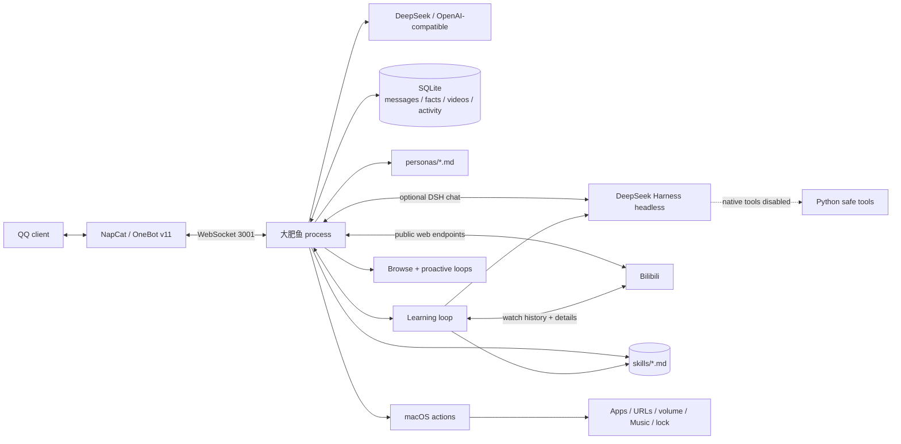

# Architecture

## High-level flow

## Modules

| Module | Responsibility |
| --- | --- |
| `config.py` | `.env`, path resolution (`DAFEIYU_HOME`), validation |
| `app.py` | entry point, `--check`, `--test-qq`, `--persona-*`, `run_app` |
| `onebot.py` | OneBot v11 client, message/request parsing, reconnect, send |
| `router.py` | allowlists, group wake words, commands, message splitting |
| `agent.py` | system prompt assembly, tool loop, proactive composition |
| `persona.py` | Markdown persona cards, hot reload, character limit |
| `llm.py` | OpenAI-compatible chat completion with retries |
| `bilibili.py` | Bilibili public API, WBI signing, rate limits, risk-control fallback, watch history |
| `learning.py` | watch-history learning loop; turns watched videos into skill cards |
| `skills.py` | local Markdown skill store, search, prompt injection |
| `dsh.py` | optional DeepSeek Harness headless runtime for skill summarization |
| `memory.py` | SQLite schema and queries |
| `scheduler.py` | autonomous browsing and proactive chat |
| `computer.py` | fixed, validated macOS actions |
| `activity.py` | frontmost-app sampler with privacy filters |
| `screen.py` | on-demand screen capture + local Vision OCR; temp image deleted |
| `stickers.py` | QQ face catalog, mood search, and `[[face:id]]` markers |
| `gui.py` | Tkinter macOS console |

## Message lifecycle

1. NapCat pushes a OneBot event over WebSocket.
2. `OneBotClient` parses messages and friend requests.
3. `Router` checks the private/group allowlists and wake words.
4. `Agent` builds the prompt: persona card + facts + recent videos + recent private activity + matched skill summaries (private only) + history.
5. The model may call tools:
   - Bilibili: hot, ranking, search, video details, comments.
   - Memory: remember, recall, recent activity.
   - Skills: `skill_search`, `skill_read` (owner-only private).
   - Stickers: `sticker_search` for mood-appropriate QQ faces.
   - macOS: `computer` (owner-only), `screen_read` (owner-only, explicit ask, OCR).
6. Tool results are returned to the model; final text is stored and split for QQ.

## Learning loop

- `LearningLoop` requires `BILI_COOKIE` with `SESSDATA`; it reads `/x/web-interface/history/cursor`.
- Videos watched at least `LEARNING_MIN_WATCH_SECONDS` (or completed, `progress = -1`) and not in `learned_videos` are candidates.
- For each candidate it fetches details, tags, comments, and optional subtitles, then asks the model (or DSH headless) for a Markdown skill card.
- Empty/entertainment results (`[SKIP]`) and low-information results are marked learned without creating a skill.
- Skill files live in `APP_HOME/skills/*.md`; `learned_videos` prevents repeat work.
- On private chats, `Agent` injects up to `SKILL_INJECT_LIMIT` matching summaries; the model can read full cards with tools.

## Proactive loop

- `BrowseLoop` fetches hot/ranking videos and stores unseen items.
- `ProactiveScheduler` waits 50–140 minutes (configurable), respects quiet hours, daily limits, and recent user activity.
- It prefers an unshared video and asks the model for a short natural message; `[SKIP]` suppresses it.
- A forced `/主动` bypasses the timer (owner only).

## Data model

| Table | Purpose |
| --- | --- |
| `messages` | per-session chat history |
| `facts` | long-term "记住" items |
| `videos` | Bilibili items seen/shared |
| `activity` | frontmost app/window samples, pruned by retention |
| `computer_actions` | audit log of macOS actions |
| `learned_videos` | Bilibili videos already processed by the learning loop |
| `state` | scheduler/session key-value state |

The database lives under `DAFEIYU_HOME/data/dafeiyu.db` (default: project root for CLI, `~/Library/Application Support/Dafeiyu` for the app).

## Security boundaries

- Computer tools require `session_id == private:<OWNER_QQ>`; group/stranger calls are rejected.
- The model never supplies a shell command; actions are an enum with validated arguments.
- Activity data and skill summaries are private-chat context only.
- Skill tools are owner-only; group calls return an error.
- No screenshots, keystrokes, clipboard, or file deletion.
- `.env` and `data/` are gitignored.

## Packaging

`scripts/mac_app_entry.py` + PyInstaller produce `dist/Dafeiyu.app`. The app keeps mutable state in `~/Library/Application Support/Dafeiyu`; the bundle itself is read-only. See [PACKAGING.md](PACKAGING.md).
